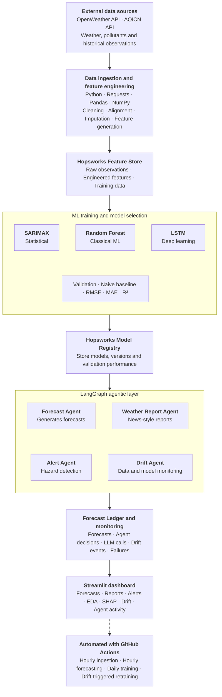

# AgentWeather-10pshine

## Development Milestones

| # | Phase | Focus | Status |
|---|-------|-------|--------|
| 1 | **Phase 0: Project foundation** | Environment, architecture, GitHub repository, configuration | 🟢 Start here |
| 2 | **Phase 1: Data ingestion** | OpenWeather, AQICN, API integration and raw observations | ⬜ Planned |
| 3 | **Phase 2: Data engineering and feature pipeline** | Cleaning, alignment, imputation, feature engineering and backfill | ⬜ Planned |
| 4 | **Phase 3: Hopsworks Feature Store** | Feature groups, feature views and historical training datasets | ⬜ Planned |
| 5 | **Phase 4: EDA and statistical forecasting** | Exploratory analysis, time-series analysis and naive baseline | ⬜ Planned |
| 6 | **Phase 5: Model training** | SARIMAX, Ridge/Random Forest, LSTM, evaluation and registry | ⬜ Planned |
| 7 | **Phase 6: Forecast and Alert agents** | LangGraph, forecasting, rule-based alerts and Groq reports | ⬜ Planned |
| 8 | **Phase 7: Drift detection and monitoring** | Data drift, model drift, logs and automated retraining triggers | ⬜ Planned |
| 9 | **Phase 8: CI/CD and automation** | GitHub Actions, scheduled pipelines and deployment automation | ⬜ Planned |
| 10 | **Phase 9: Dashboard and final deployment** | Streamlit, SHAP, reports, monitoring and final documentation | ⬜ Planned |

---

## AgentWeather Architecture

